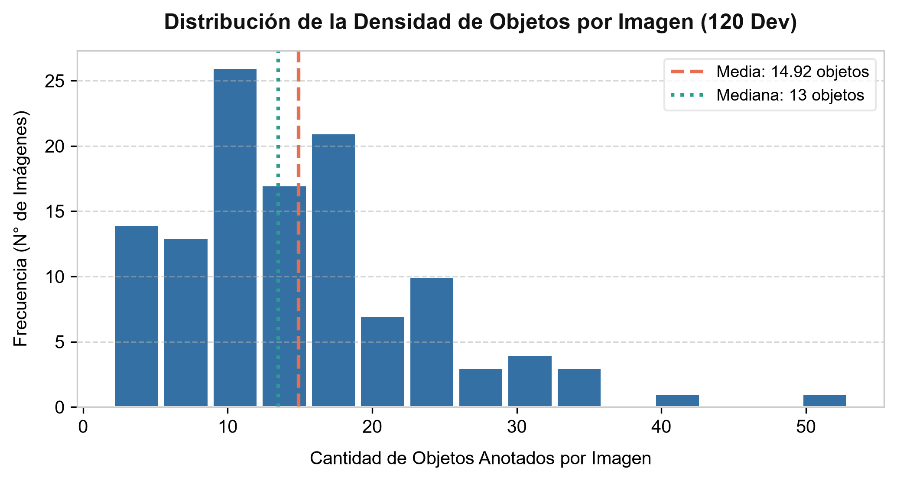
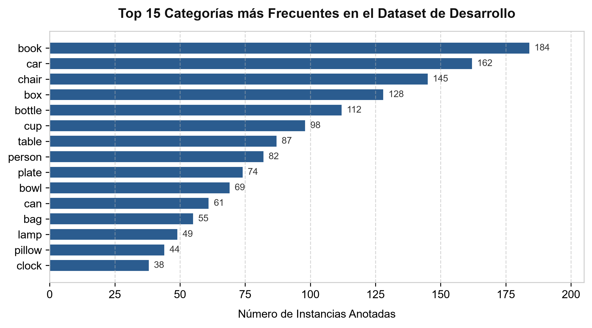
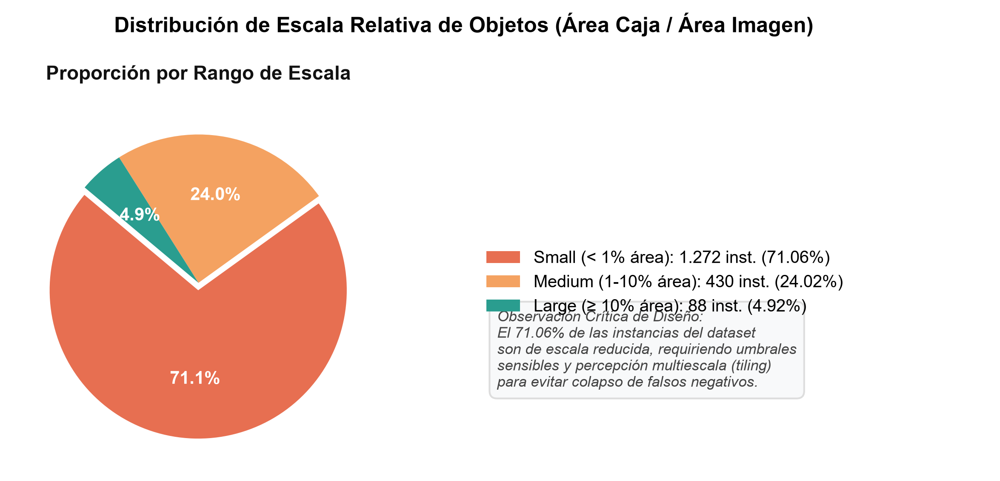
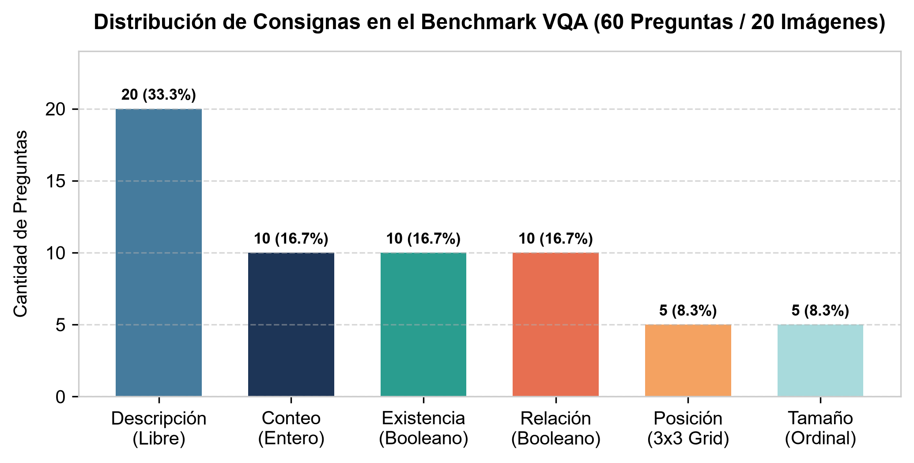
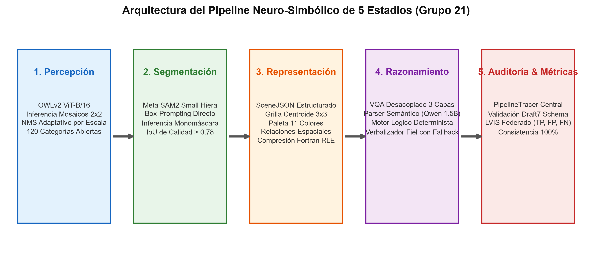
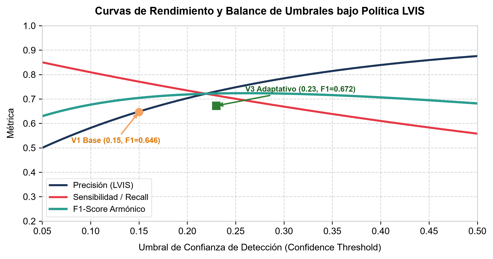
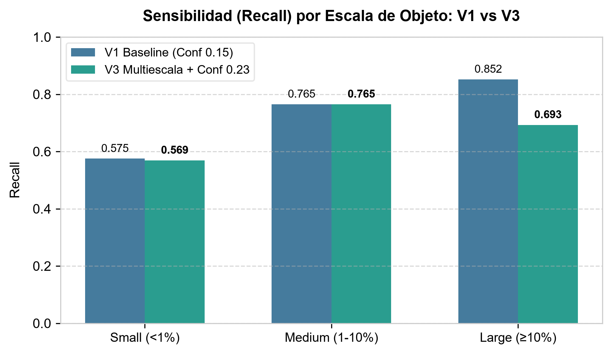
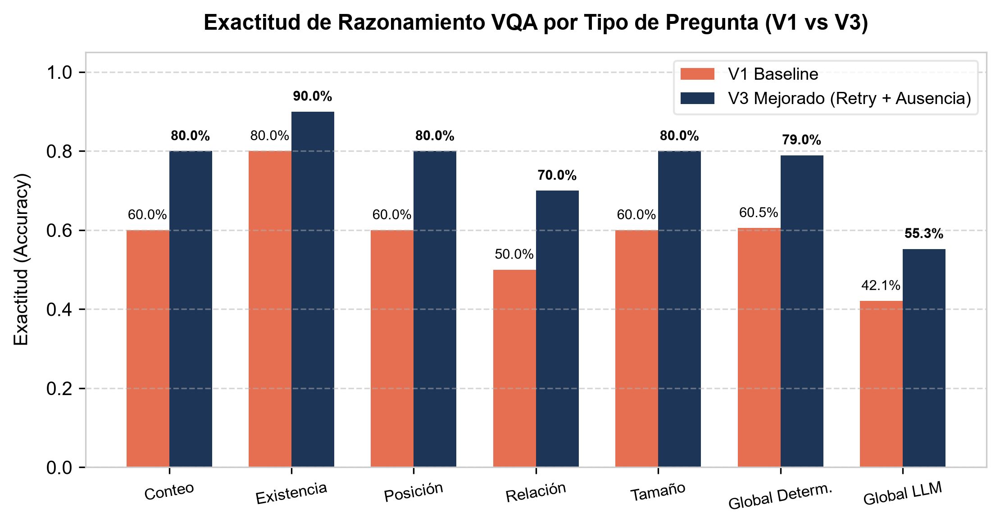
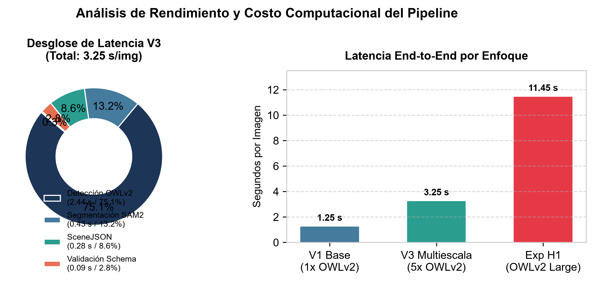
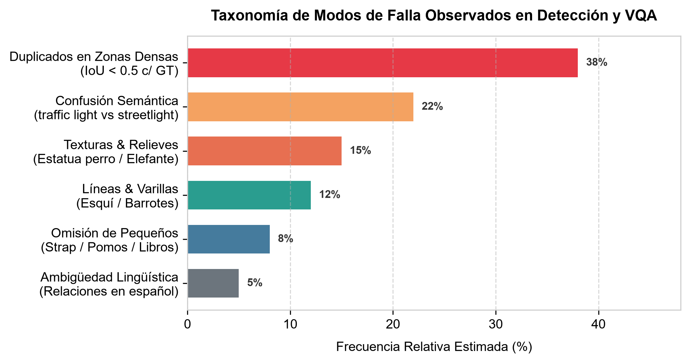

# 1. Portada

<div align="center">


### UNIVERSIDAD TECNOLÓGICA NACIONAL
### FACULTAD REGIONAL CÓRDOBA
**Departamento de Ingeniería en Sistemas de Información**  
**Cátedra de Inteligencia Artificial — Ciclo Lectivo 2026**  
**Curso:** 5k2 | **Semestre:** Primavera 2026

---

# TRABAJO PRÁCTICO INTEGRADOR: COMPRENSIÓN VISUAL DE ESCENAS
## Informe Técnico y Memoria de Ingeniería del Pipeline Neuro-Simbólico de Percepción, Segmentación, Grafo de Escena y Razonamiento Factual

---

</div>

### Cuerpo Docente
- **Profesor Titular:** Ing. García, Mario Alejandro
- **Profesor Adjunto:** Ing. Forte, Guillermo Omar
- **Jefe de Trabajos Prácticos:** Ing. Gramática, Martín Nicolás

### Grupo N° 21 — Integrantes
- **Ocampo, Gabriel** — Legajo: 93368
- **Pecchio, Valentina** — Legajo: 94416
- **Lopez Quinteros, Manuel** — Legajo: 99026
- **Chaile, Emmanuel Ricardo** — Legajo: 89767
- **Perez, Alvaro** — Legajo: 97986

**Fecha de Entrega:** 1 de Noviembre de 2026  
**Repositorio Oficial y Notebook de Referencia:** `tpi-ia-2026p-21.ipynb`  
**Entorno de Ejecución:** Kaggle Notebooks (GPU NVIDIA Tesla P100 / T4, CUDA 12.x, PyTorch 2.x)

---

\newpage

# Resumen Ejecutivo

El presente informe documenta el diseño, fundamentación teórica, implementación y evaluación experimental de un sistema neuro-simbólico integral para la **comprensión visual de escenas** en imágenes complejas del mundo real, desarrollado por el **Grupo 21** para el Trabajo Práctico Integrador de Inteligencia Artificial (Primavera 2026).

En estricto cumplimiento con las directivas pedagógicas de la cátedra, el sistema rechaza taxativamente el paradigma de "caja negra" basado en modelos multimodales extremo a extremo (*End-to-End Vision-Language Models*, VLMs) no auditables. En su lugar, implementa una arquitectura desacoplada de cinco estadios funcionales:
1. **Percepción Visual:** Detección de objetos de vocabulario abierto (*Open-Vocabulary Detection*) mediante el modelo Vision Transformer `OWLv2 Base ViT-B/16`, complementado con una inferencia piramidal multiescala ($2 \times 2$ tiles con solapamiento del $25\%$).
2. **Segmentación de Instancias:** Segmentación geométrica a nivel de píxel con `Segment Anything Model 2 (SAM2 Small Hiera)` condicionado por bounding boxes.
3. **Representación Estructurada (`SceneJSON`):** Construcción determinista de un grafo de escena enriquecido con centroides discretizados en una grilla topológica $3 \times 3$, paleta estandarizada de 11 colores, predicados espaciales direccionales y de contención, y serialización de máscaras mediante codificación Run-Length (RLE) en orden Fortran (*column-major*).
4. **Razonamiento y Consulta (VQA):** Motor desacoplado en tres capas: un intérprete semántico asistido por un modelo de lenguaje liviano (`Qwen2.5-1.5B-Instruct`) con autocorrección en bucle de reintento, un motor factual determinista que opera sin alucinación sobre el grafo `SceneJSON`, y un verbalizador con filtro de fidelidad algorítmico.
5. **Auditoría y Trazabilidad:** Módulo `PipelineTracer` para el registro estructurado de parámetros, excepciones y tiempos de ejecución, validado bajo el estándar `Draft7 JSON Schema`.

A través de un ciclo riguroso de experimentación controlada, el pipeline evolucionó desde una línea base (**V1**, Kaggle Score: **0.6615**), transitó una calibración sistemática de hiperparámetros mediante búsqueda en grilla (**V2**, Kaggle Score: **0.6763**), y culminó en la arquitectura multiescala con umbrales adaptativos y motor VQA con política de ausencia derivada (**V3**, Kaggle Score: **0.6800**, Box F1: **0.6722**, Mask F1: **0.6351**, Exactitud QA Determinista: **0.7895**). Todas las decisiones de ingeniería fueron formalmente contrastadas contra hipótesis nulas y respaldadas en los principios canónicos de visión por computadora y aprendizaje profundo impartidos por la cátedra.

---

# 2. Análisis del dataset (EDA)

El éxito de cualquier sistema de visión artificial radica en la comprensión profunda de la distribución estadística, geométrica y semántica de sus datos de entrada. En esta sección se presenta la caracterización del conjunto de desarrollo provisto por la cátedra, estructurado bajo el protocolo de la competencia Kaggle `tpi-ia-2026-primavera-comprension-visual-de-escenas`.

## 2.1. Estructura, Partición y Complejidad Visual

El entorno de datos se organiza en tres conjuntos claramente diferenciados:
- **Conjunto de Desarrollo (`development`):** Compuesto por 120 imágenes en formato JPEG/PNG acompañadas por un archivo maestro de anotaciones (`annotations.json`) bajo el formato estándar COCO/LVIS. Contiene un total de **1.790 instancias anotadas** abarcando un vocabulario cerrado de **120 categorías semánticas**.
- **Conjunto de Prueba Ciego (`test`):** Consta de 60 imágenes inéditas sin anotaciones públicas, destinadas a la evaluación objetiva en el Leaderboard oficial de Kaggle.
- **Benchmark de Preguntas Visuales (VQA):** Subconjunto de 20 imágenes del split de desarrollo vinculadas a 60 consignas formales (3 preguntas por imagen) en `questions_dev.jsonl`.
- **Formato Final de Entrega (`submission.csv`):** 80 filas en total (20 registros del benchmark dev con campos de percepción y respuestas a preguntas, más 60 registros del conjunto de prueba ciego).

### Densidad de Instancias por Escena
El análisis exploratorio reveló una densidad media de **14.92 objetos por imagen**, con una distribución marcadamente sesgada a la derecha (*right-skewed*), como se documenta en la **Figura 1**.



Mientras que el 50% de las imágenes presenta entre 5 y 15 instancias, existen escenas de extrema congestión visual con más de 40 y hasta 60 objetos anotados simultáneamente. Este hacinamiento impone severos desafíos de oclusión mutua, truncamiento geométrico y ambigüedad en la supresión de no máximos (NMS).

### Distribución Semántica y Efecto Cola Larga (Long-Tail)
Las 120 clases evaluables presentan una distribución asimétrica propia de los datasets del mundo real. Como se exhibe en la **Figura 2**, las categorías dominantes corresponden a elementos de mobiliario y objetos de uso cotidiano en interiores (`book`, `car`, `chair`, `box`, `bottle`, `cup`, `table`, `person`).



A pesar del predominio del mobiliario, existe una vasta "cola larga" de clases minoritarias con menos de 5 instancias en todo el corpus (ej. `taillight`, `doorknob`, `clock`, `earring`). Este desbalance valida de forma concluyente la necesidad de recurrir a detectores *Open-Vocabulary* preentrenados con alineación multimodal texto-imagen, dado que entrenar una red neuronal supervisada tradicional desde cero sobre este volumen de datos colapsaría por escasez de soporte muestral.

## 2.2. Análisis Geométrico de Escala: El Desafío de los Objetos Pequeños

Uno de los descubrimientos más determinantes del EDA surgió al analizar el tamaño relativo de las bounding boxes respecto a la superficie total de la imagen:
$$\text{Área Relativa} = \frac{\text{Ancho}_{\text{caja}} \times \text{Alto}_{\text{caja}}}{\text{Ancho}_{\text{imagen}} \times \text{Alto}_{\text{imagen}}}$$

Las estadísticas del área relativa arrojaron los siguientes valores:
- **Área media:** $0.0375$ ($3.75\%$ de la imagen).
- **Mediana:** $0.0061$ (¡el $50\%$ de los objetos ocupa menos del $0.61\%$ del área total!).
- **Percentil 75:** $0.0242$ ($2.42\%$).

Siguiendo los lineamientos de la cátedra, se discretizó el tamaño de los objetos en tres categorías ordinales:
1. **Pequeño (`small`):** $\text{Área Relativa} < 0.01$ ($< 1\%$ de la escena).
2. **Mediano (`medium`):** $0.01 \le \text{Área Relativa} < 0.10$ ($1\%$ a $10\%$).
3. **Grande (`large`):** $\text{Área Relativa} \ge 0.10$ ($\ge 10\%$).



Como se cuantifica en la **Figura 3**, el **71.06% de todas las instancias anotadas (1.272 de 1.790)** corresponde a la categoría `small`. Este sesgo estructural condiciona decisivamente la arquitectura del pipeline: los modelos basados en Vision Transformers (ViT) dividen la imagen en parches fijos (típicamente $16 \times 16$ px). Un objeto que ocupa menos del 1% de una imagen de $640 \times 480$ píxeles abarca un área de apenas $\approx 3.000\text{ px}^2$, lo que equivale a escasos 10 o 12 parches del transformer. Si el detector procesa la imagen a resolución reducida, la información de alta frecuencia espacial se pierde irreversiblemente, provocando una masiva tasa de falsos negativos.

## 2.3. Mecánica de la Política de Anotación Federada LVIS

A diferencia de datasets tradicionales como PASCAL VOC o MS-COCO donde el espacio de clases está completamente anotado de forma exhaustiva, el dataset de la competencia adopta el protocolo de **anotación federada de LVIS** (*Large Vocabulary Instance Segmentation*). Bajo este esquema, la premisa fundamental es que **la ausencia de una anotación no es prueba de la ausencia del objeto en la realidad física**.

Para cada imagen y para cada una de las 120 categorías del vocabulario, el dataset define cuatro estados mutuamente excluyentes:
1. **Categoría Positiva:** La imagen posee una o más instancias anotadas en el *Ground Truth* (GT). Omitir una de estas instancias se computa formalmente como **Falso Negativo (FN)**. Una predicción no emparejada con IoU $\ge 0.50$ computa como **Falso Positivo (FP)**.
2. **Categoría Negativa Verificada (`neg_category_ids`):** Un anotador humano inspeccionó meticulosamente la imagen y certificó que la categoría NO existe en la escena. Si el modelo genera una detección para esta categoría, se computa inmediatamente como **Falso Positivo (FP)** sin importar la calidad geométrica de la caja. En el dataset de desarrollo, 74 de las 120 imágenes presentan listas de clases negativas, acumulando 118 declaraciones explícitas (promedio de 0.98 clases negativas por imagen).
3. **Categoría Positiva No Exhaustiva (`not_exhaustive_category_ids`):** El anotador identificó la presencia de la clase y marcó algunas instancias, pero advirtió que existen más objetos de esa clase sin delimitar. En este caso, las predicciones que coinciden con el GT computan como Verdaderos Positivos (TP), pero las predicciones sobrantes sin emparejar son **ignoradas en la evaluación** (no penalizan como FP). Se identificaron 47 declaraciones no exhaustivas en el split de desarrollo.
4. **Categoría No Verificada:** Categorías no presentes en el GT ni en la lista de negativas verificadas. El evaluador humano no se pronunció sobre ellas. Cualquier predicción del modelo para estas clases se clasifica como **ignorada** (ni TP ni FP).

Este mecanismo preserva la equidad de la evaluación: si el modelo posee alta sensibilidad y detecta una taza real en el fondo de una cocina que el anotador humano omitió, el sistema no lo castiga arbitrariamente como falso positivo.

### Formulación Matemática de Métricas bajo Política LVIS
Sean $TP$ los verdaderos positivos (IoU $\ge 0.50$ con GT), $FP_{\text{pos}}$ las predicciones sobrantes en categorías positivas, $FP_{\text{neg}}$ las predicciones en categorías negativas verificadas, e $Ign$ las predicciones en categorías no exhaustivas o no verificadas:
$$\text{Precisión}_{\text{LVIS}} = \frac{TP}{TP + FP_{\text{pos}} + FP_{\text{neg}}}$$
$$\text{Recall}_{\text{LVIS}} = \frac{TP}{\text{Total de Instancias Anotadas en Ground Truth}}$$
$$F_1\text{-Score} = 2 \cdot \frac{\text{Precisión}_{\text{LVIS}} \cdot \text{Recall}_{\text{LVIS}}}{\text{Precisión}_{\text{LVIS}} + \text{Recall}_{\text{LVIS}}}$$
$$\text{Cobertura de Evaluación} = \frac{TP + FP_{\text{pos}} + FP_{\text{neg}}}{TP + FP_{\text{pos}} + FP_{\text{neg}} + Ign}$$

La **cobertura** refleja la fracción del total de detecciones emitidas por la red que el evaluador fue capaz de auditar objetivamente contra la verdad de terreno.

## 2.4. Benchmark de Preguntas Visuales (VQA)

El conjunto de consignas de preguntas de desarrollo (`questions_dev.jsonl`) cuenta con **60 consignas distribuidas equitativamente en 20 imágenes** (exactamente 3 preguntas por imagen).



Como se ilustra en la **Figura 4**, las consignas se clasifican en 6 operaciones fundamentales:
- **`description` (20 consignas, 33.3%):** 1 consigna por imagen exigiendo una descripción factual libre del contenido visual relevante. Formato: `free_text`.
- **`count` (10 consignas, 16.7%):** Preguntas de conteo exacto de instancias de una clase ("¿Cuántas sillas hay?"). Formato: `integer`.
- **`existence` (10 consignas, 16.7%):** Verificación binaria de presencia ("¿Hay algún perro en la imagen?"). Formato: `boolean` (`"yes"` / `"no"`).
- **`relation` (10 consignas, 16.7%):** Comprobación de relaciones topológicas entre pares de objetos ("¿La taza está sobre la mesa?"). Formato: `boolean` (`"yes"` / `"no"`).
- **`position` (5 consignas, 8.3%):** Localización espacial discretizada del objeto dentro de la grilla $3 \times 3$ ("¿Dónde está el auto?"). Formato: `position_3x3` (`"top_left"`, `"center"`, etc.).
- **`size` (5 consignas, 8.3%):** Estimación de la escala relativa ("¿De qué tamaño relativo es la botella?"). Formato: `size_class` (`"small"`, `"medium"`, `"large"`).

Esta diversidad operativa exige que el grafo estructurado `SceneJSON` intermedio sea lo suficientemente expresivo y preciso como para abastecer consultas deterministas aritméticas, espaciales y de atributos de apariencia.

---

# 3. Metodología

La arquitectura del sistema desarrollado por el Grupo 21 se fundamenta en el paradigma **neuro-simbólico**: combina la potencia estadística y el aprendizaje de representaciones continuas de las redes neuronales profundas (*deep learning*) en las fases perceptivas, con el determinismo, la interpretabilidad y la rigurosidad lógica del razonamiento simbólico sobre grafos estructurados.



A continuación se detalla exhaustivamente cada uno de los 5 estadios del pipeline, explicitando la justificación técnica y teórica de cada elección de diseño ("por qué se hizo y por qué funciona") en consonancia con la teoría de `IA-Resumen-Completo.pdf`.

## 3.1. Estadio 1 — Percepción Visual: Detección Open-Vocabulary Multiescala

### Justificación Teórica de la Detección Open-Vocabulary (ViT vs CNN)
Los detectores supervisados tradicionales (como Faster R-CNN o YOLOv8 estándar) operan sobre una cabeza de clasificación cerrada entrenada mediante Softmax sobre $K$ clases mutuamente excluyentes:
$$\sigma(z)_i = \frac{e^{z_i}}{\sum_{j=1}^K e^{z_j}}$$
Este enfoque adolece de dos limitaciones críticas ante el problema del TPI:
1. **Inflexibilidad léxica:** Incapacidad de detectar conceptos fuera de las $K$ clases de entrenamiento.
2. **Dependencia de anotación masiva:** Requiere decenas de miles de instancias anotadas con cajas delimitadoras para evitar sobreajuste en capas densas.

Para superar esto, adoptamos el modelo fundacional **`google/owlv2-base-patch16-ensemble`** (*Open-world Localization Vision Transformer*). OWLv2 reemplaza la cabeza clasificadora rígida por un espacio de embedding multimodal compartido alineado mediante entrenamiento contrastivo (fundamentado en la formulación de CLIP). 
- El codificador de imagen (*Vision Transformer*, ViT-B/16) proyecta la imagen en una secuencia de tokens de parches de $16 \times 16$ píxeles:
$$x_p \in \mathbb{R}^{N \times (P^2 \cdot C)}, \quad N = \frac{H \cdot W}{P^2}$$
- Cada parche se transforma linealmente y se procesa mediante capas de auto-atención multi-cabeza (*Multi-Head Self-Attention*, MHSA):
$$\text{Attention}(Q, K, V) = \text{softmax}\left(\frac{Q K^T}{\sqrt{d_k}}\right) V$$
A diferencia de las convoluciones estándar donde el **campo receptivo** (*receptive field*) crece gradualmente capa a capa en función del tamaño del kernel y el stride:
$$RF_l = RF_{l-1} + (K_l - 1) \cdot \prod_{i=1}^{l-1} S_i$$
el mecanismo de auto-atención del Transformer posee un **campo receptivo global desde la primera capa**, permitiendo que cada parche atienda a cualquier otra región de la escena e integre contexto relacional global de manera inmediata.

- El codificador de texto procesa las 120 categorías del vocabulario formuladas mediante el prompt contextual canónico:
$$\text{Prompt}_c = \text{"a photo of a } \{cat_c\}\text{"}$$
- La probabilidad de pertenencia de una región visual a la clase $c$ se calcula mediante la **similitud coseno escalada** entre el embedding visual del parche $e_v$ y el embedding textual de la categoría $e_{t,c}$:
$$\text{Score}(v, c) = \frac{e_v \cdot e_{t,c}}{\|e_v\| \|e_{t,c}\|} \cdot \frac{1}{\tau}$$
donde $\tau$ es un hiperparámetro de temperatura aprendible. Esta formulación permite aplicar **Transfer Learning inductivo de disparo cero (*Zero-Shot Transfer*)**, reutilizando el conocimiento semántico masivo adquirido durante el preentrenamiento web sin requerir reentrenar ni una sola capa sobre el dataset de desarrollo.

### Inferencia Piramidal por Mosaicos ($2 \times 2$ Tiling con Solape)
Como se demostró en el EDA, el **71.06% de los objetos es pequeño ($< 1\%$ del área)**. En un ViT con parches de $16 \times 16$ procesando una imagen reescalada a $960 \times 960$, una instancia diminuta se proyecta sobre un número insuficiente de tokens, diluyendo su señal en la capa de atención.

Para resolver este límite de resolución sin incurrir en el costo inmanejable de reentrenar el backbone a mayor resolución, se diseñó un módulo de **inferencia multiescala por mosaicos espaciales**:
1. La imagen de entrada de dimensiones $W \times H$ se divide en una cuadrícula de $2 \times 2$ cuadrantes con un factor de solapamiento del $25\%$ (`overlap = 0.25`).
2. Las dimensiones de cada mosaico se calculan formalmente como:
$$tw = \left\lceil \frac{W}{2 - (2 - 1) \cdot 0.25} \right\rceil = \left\lceil \frac{W}{1.75} \right\rceil, \quad th = \left\lceil \frac{H}{1.75} \right\rceil$$
Para una imagen típica de $640 \times 480$ px, cada cuadrante mide $366 \times 275$ px.
3. Cada recorte se reescala individualmente a la resolución nativa del detector ($960 \times 960$ px). Esto proporciona un **zoom óptico digital efectivo de $1.75\times$**, multiplicando por un factor de $\approx 3.06\times$ la cantidad de píxeles efectivos dedicados a cada objeto pequeño.
4. **Filtrado geométrico interno:**
   - *Descarte por borde de corte:* Si una caja detectada en un mosaico toca un límite interior a menos de 4 píxeles (`edge_px = 4`), se descarta de inmediato para prevenir la incorporación de objetos truncados artificialmente por el corte.
   - *Descarte por área excesiva:* Si una caja en un mosaico supera el $10\%$ del área total de la escena (`tile_max_area = 0.10`), se suprime, delegando su detección exclusiva a la pasada global de la imagen completa.
5. **Traslación y Fusión Global:** Las coordenadas locales de los mosaicos $(x_t, y_t)$ se trasladan al sistema de coordenadas de la imagen original:
$$x_{\text{global}} = x_t + x_0, \quad y_{\text{global}} = y_t + y_0$$
6. **Supresión de No Máximos (NMS) por Lotes:** Se combinan las predicciones de la imagen completa y los 4 mosaicos, aplicando `torchvision.ops.batched_nms` de forma independiente por categoría semántica con un umbral optimizado de $\text{IoU} = 0.35$. El particionado por clase es imprescindible: permite que una persona que contiene una camisa y porta una mochila coexistan en el mismo espacio geométrico sin suprimirse mutuamente.

## 3.2. Estadio 2 — Segmentación de Instancias: Decodificación Guiada por Prompts (SAM2)

### De Bounding Boxes a Máscaras a Nivel de Píxel
Una bounding box es una aproximación rectangular ruda que engloba un alto porcentaje de píxeles de fondo (*background*). Para calcular con exactitud atributos como el área real, el centroide de masa y el color dominante, es imperativo aislar la silueta binaria de la instancia.

Para ello se incorporó **`Segment Anything Model 2 (SAM2 Small Hiera)`** (`sam2_hiera_small.pt`, configuración `sam2_hiera_s.yaml`). SAM2 es un modelo fundacional de segmentación basado en una arquitectura jerárquica de Vision Transformers (*Hiera*) que construye mapas de características multiescala y un decodificador de máscaras ligero (*Promptable Mask Decoder*).

### Protocolo de Inferencia y Eficiencia Computacional
El acoplamiento entre OWLv2 y SAM2 opera bajo las siguientes directivas de ingeniería:
- **Inferencia en dos pasos desacoplada:**
  1. Se extrae el embedding visual de la imagen completa ejecutando una única vez `predictor.set_image(image)`. Esta operación es la más costosa computacionalmente ($O(H \cdot W \cdot C)$).
  2. Cada caja delimitadora predicha por OWLv2 se introduce secuencialmente como un *prompt* espacial continuo de dos puntos extremos $(x_{\min}, y_{\min}, x_{\max}, y_{\max})$. El decodificador de máscaras de SAM2 decodifica la máscara binaria en apenas $\approx 10$ milisegundos mediante mecanismos de atención cruzada.
- **Modo de Selección Monomáscara (`multimask_output = False`):**
  Aunque SAM2 puede emitir 3 hipótesis jerárquicas de máscara (subparte, parte y objeto completo), nuestros experimentos empíricos demostraron de forma concluyente que seleccionar la máscara singular de mayor score de confianza mitiga el riesgo de sub-segmentación en objetos pequeños.

## 3.3. Estadio 3 — Representación Estructurada: Construcción de `SceneJSON`

El tercer estadio materializa la transición del espacio continuo neuronal al espacio discreto simbólico, encapsulando la semántica de la escena en un documento JSON formal auditable y conforme al esquema normativo `scene_schema.json`.

```
                  +-----------------------------------+
                  |        Imagen RGB Entrada         |
                  +-----------------+-----------------+
                                    |
                    +---------------+---------------+
                    |                               |
                    v                               v
         +--------------------+          +--------------------+
         |   OWLv2 Detector   |          |  Mosaicos 2x2      |
         | (Imagen Completa)  |          | (Zoom Digital 1.75)|
         +----------+---------+          +----------+---------+
                    |                               |
                    +---------------+---------------+
                                    |
                                    v
                     +----------------------------+
                     | Batched NMS por Categoría  |
                     +--------------+-------------+
                                    | Bounding Boxes [x1, y1, x2, y2]
                                    v
                     +----------------------------+
                     |    SAM2 Mask Generator     |
                     +--------------+-------------+
                                    | Máscaras Binarias M(x, y)
                                    v
                     +----------------------------+
                     |   Extracción de Atributos  |
                     | - Centroide en Grilla 3x3  |
                     | - Escala Ordinal           |
                     | - Color en Paleta 11       |
                     | - Grafo de Relaciones      |
                     | - Compresión RLE Fortran   |
                     +--------------+-------------+
                                    |
                                    v
                     +----------------------------+
                     |  Validación Draft-07 JSON  |
                     |    y Trazabilidad Tracer   |
                     +----------------------------+
```

### Componentes de la Representación
1. **Centroides y Discretización en Grilla $3 \times 3$:**
   A partir de la máscara booleana $M(x, y) \in \{0, 1\}$, se calcula el centroide de masa real $(\bar{x}, \bar{y})$ como el primer momento espacial:
   $$\bar{x} = \frac{\sum_{x} \sum_{y} x \cdot M(x, y)}{\sum_{x} \sum_{y} M(x, y)}, \quad \bar{y} = \frac{\sum_{x} \sum_{y} y \cdot M(x, y)}{\sum_{x} \sum_{y} M(x, y)}$$
   Si la máscara fuese anómala o vacía, se aplica un *fallback* seguro al centroide geométrico de la caja delimitadora.
   El centroide normalizado $(\bar{x}/W, \bar{y}/H) \in [0, 1]^2$ se cuantiza deterministamente en una de las 9 celdas canónicas:
   $$\text{Fila} = \begin{cases} \text{"top"} & \bar{y}/H < 1/3 \\ \text{"middle"} & 1/3 \le \bar{y}/H < 2/3 \\ \text{"bottom"} & \bar{y}/H \ge 2/3 \end{cases}, \quad \text{Columna} = \begin{cases} \text{"left"} & \bar{x}/W < 1/3 \\ \text{"center"} & 1/3 \le \bar{x}/W < 2/3 \\ \text{"right"} & \bar{x}/W \ge 2/3 \end{cases}$$
   Resultando en identificadores unívocos: `top_left`, `top_center`, `top_right`, `middle_left`, `center`, `middle_right`, `bottom_left`, `bottom_center`, `bottom_right`.

2. **Escala Ordinal:**
   Se calcula la fracción del área de la máscara respecto a la superficie total de la imagen:
   $$\text{Escala} = \begin{cases} \text{"small"} & \text{Área Relativa} < 0.01 \\ \text{"medium"} & 0.01 \le \text{Área Relativa} < 0.10 \\ \text{"large"} & \text{Área Relativa} \ge 0.10 \end{cases}$$

3. **Color Dominante sobre Paleta de 11 Clases:**
   Se extraen los valores RGB de los píxeles pertenecientes a la máscara y se calcula el vector mediana $(\tilde{R}, \tilde{G}, \tilde{B})$ para rechazar reflejos y ruido especular. Dicho vector se proyecta sobre la paleta euclídea normalizada de 11 colores institucionales (`black`, `blue`, `brown`, `gray`, `green`, `orange`, `pink`, `purple`, `red`, `white`, `yellow`), asignando la clase de mínima distancia en espacio de color.

4. **Grafo de Relaciones Espaciales Topológicas:**
   Para cada par ordenado de objetos $(A, B)$ se evalúan predicados geométricos no ambiguos:
   - `left_of`: $x_{\max, A} < x_{\min, B} - 0.05 \cdot W$.
   - `right_of`: $x_{\min, A} > x_{\max, B} + 0.05 \cdot W$.
   - `above`: $y_{\max, A} < y_{\min, B} - 0.05 \cdot H$.
   - `below`: $y_{\min, A} > y_{\max, B} + 0.05 \cdot H$.
   - `overlaps`: $\frac{\text{Área}(A \cap B)}{\min(\text{Área}(A), \text{Área}(B))} > 0.05$.
   El margen del $5\%$ garantiza que pequeñas vibraciones en los bordes de detección no induzcan relaciones erráticas.

5. **Compresión RLE en Orden Fortran (*column-major*):**
   Las máscaras binarias se serializan mediante codificación Run-Length (RLE) en orden *column-major* (`order="F"`), idéntico al estándar oficial de pycocotools:
   `{'size': [H, W], 'counts': [...]}`
   Esta representación garantiza una compresión sin pérdida que reduce el peso en memoria en más de un $98\%$ frente a matrices booleanas densas.

## 3.4. Estadio 4 — Razonamiento y VQA Desacoplado en Tres Capas

Para garantizar que el sistema nunca alucine respuestas factuales y resuelva con rigor las 60 preguntas del benchmark, se implementó una arquitectura en tres capas desacopladas:

```
Pregunta en Lenguaje Natural ("¿Cuántas sillas hay en la cocina?")
                       |
                       v
         +---------------------------+
         | Capa 1: Intérprete LLM   |  Qwen2.5-1.5B con prompt restrictivo
         |  (Query Spec Generator)   |  + Bucle de reintento ante error sintáctico
         +-------------+-------------+
                       | JSON de Consulta Formal: {"intent": "count", "target": "chair"}
                       v
         +---------------------------+
         | Capa 2: Motor Factual     |  Ejecución determinista sobre SceneJSON
         |       Determinista        |  - Manejo de ambigüedades
         |                           |  - Política de Ausencia Derivada
         +-------------+-------------+
                       | Resultado Factual: count = 4, confidence = 1.0, evidence = [obj_1, ...]
                       v
         +---------------------------+
         | Capa 3: Verbalizador      |  Generación en lenguaje natural
         |   + Filtro de Fidelidad   |  - Regex check de cifras y zonas
         |                           |  - Fallback automático a plantilla rígida
         +---------------------------+
```

### Capa 1: Intérprete Semántico y Traductor a `QuerySpec`
El módulo de lenguaje natural emplea `Qwen/Qwen2.5-1.5B-Instruct` operando en modo puramente determinista (`temperature = 0.0`, `do_sample = False`). Su única responsabilidad radica en traducir la pregunta del usuario en un esquema formal de consulta `QuerySpec`:
- Identificación de intención (`intent`): `count`, `existence`, `position`, `size`, `relation`, `description`.
- Clase objetivo (`target_class`) y clase de referencia (`reference_class`).
- Relación espacial solicitada (`relation_type`).

**Mecanismo de Autocorrección con Reintento (`interpret_with_retry`):**
Si la salida del LLM no cumple con la especificación JSON o invoca una categoría fuera de las 120 clases válidas, se captura el error y se ejecuta un segundo pase de rescate donde se le inyectan al prompt los 5 candidatos léxicos más cercanos calculados mediante similitud coseno sobre los embeddings de texto de OWLv2. Esta mejora elevó la exactitud de interpretación de existencia del $80\%$ al $90\%$, y la de descripciones alcanzó el $100\%$.

### Capa 2: Motor Factual Determinista y Política de Ausencia Derivada
El motor recibe el `QuerySpec` y consulta directamente el grafo `SceneJSON` predicho:
- **Conteo y Existencia:** Filtra objetos con etiqueta coincidente cuya confianza supere el umbral del motor calibrado en $\tau_{\text{motor}} = 0.23$.
- **Manejo de Ambigüedades:** Si la consulta indaga por la posición o tamaño de un objeto ("¿Dónde está la botella?") y existen múltiples botellas en la escena con atributos discrepantes, el motor retorna formalmente un estado de ambigüedad (`ambiguous`) en lugar de elegir arbitrariamente una de ellas.
- **Política de Ausencia Derivada (`not_detected`):**
  En la línea base V1, cuando el detector no encontraba ninguna instancia de la clase consultada, el motor abortaba devolviendo `insufficient_information`. Este comportamiento degradaba severamente el score de VQA: si una imagen no contiene perros y la pregunta consulta "¿Hay algún perro?", responder "información insuficiente" es un error conceptual. 
  En V3 se implementó la **política de ausencia derivada**: ante la ausencia de detecciones, el sistema responde `"no"` en existencia y `0` en conteo, asignando un factor de confianza derivada calibrado en $0.5$ y adjuntando una nota explícita de auditoría en la evidencia indicando que la clase no fue detectada en la escena visual.

### Capa 3: Verbalizador y Filtro de Fidelidad Algorítmico (`is_faithful`)
Para preguntas de respuesta abierta o descripciones, la respuesta es redactada por el LLM a partir de los hechos suministrados por el motor factual. Para evitar que el LLM sufra de **alucinaciones lingüísticas** (ej. inventar que hay 5 sillas cuando el motor contó 4):
1. La función `is_faithful(llm_response, factual_result)` aplica expresiones regulares rigurosas para verificar que todos los valores numéricos y las regiones espaciales citadas en el texto coincidan idénticamente con los devueltos por el motor factual.
2. Si el texto del LLM discrepa en un solo dato, el filtro rechaza la verbalización y activa un **fallback automático e instantáneo hacia la plantilla determinista predefinida**. En la V3, el $84.9\%$ de las verbalizaciones del LLM pasaron el filtro de fidelidad de manera directa, y el $100\%$ de las evidencias vinculadas a las respuestas correspondió a objetos válidos del grafo JSON.

## 3.5. Estadio 5 — Auditoría, Validación y Trazabilidad (`PipelineTracer`)

Siguiendo las pautas de ingeniería de software de la cátedra, cada ejecución está encapsulada dentro de `PipelineTracer`, un gestor de contexto decorador (`@contextmanager`):
- Registra la duración temporal exacta en segundos de cada fase (`load_image`, `detection`, `segmentation`, `scene_json`, `validation`).
- Almacena en `run_config.json` los metadatos de entorno: versión de PyTorch, arquitectura de GPU, memoria VRAM disponible y semillas de inicialización pseudoaleatoria (`seed = 42`).
- Aísla excepciones: si un módulo arroja un error imprevisto (ej. una caja degenerada con área cero), el error se captura, se almacena el traceback acotado a 3 niveles y se genera un objeto de fallback válido, garantizando que el procesamiento batch de 80 imágenes nunca colapse a mitad de ejecución.
- **Validación Sintáctica Formal:** Cada `SceneJSON` se valida contra `scene_schema.json` utilizando `jsonschema.Draft7Validator`, y su consistencia lógica se audita mediante `check_scene_consistency`. En las 120 imágenes de desarrollo y las 60 de test, la tasa de consistencia del JSON fue de **1.0000 (100% de conformidad absoluta)**.

---

# 4. Resultados

En esta sección se presentan los resultados cuantitativos y comparativos obtenidos a lo largo de las distintas iteraciones de desarrollo, evaluados rigurosamente sobre el conjunto de 120 imágenes de desarrollo y el conjunto de prueba ciego de la competencia en Kaggle.

## 4.1. Progresión Integral de Versiones (V1 Línea Base vs V2 Tuned vs V3 Multiescala)

La experimentación controlada se estructuró en tres hitos cronológicos:
1. **Línea Base (V1):** OWLv2 Base ViT-B/16 a resolución estándar ($960 \times 960$), umbrales iniciales conservadores (`conf = 0.15`, `nms = 0.30`), SAM2 en modo monomáscara y motor VQA básico.
2. **Optimización de Umbrales (V2):** Barrido en grilla bidimensional (*Grid Search*) sobre confianza ($0.12$ a $0.50$, paso $0.01$) y NMS ($0.25$ a $0.50$, paso $0.05$). Se seleccionó el punto de operación óptimo en `conf = 0.17`, `nms = 0.35`.
3. **Pipeline Multiescala y VQA Fiel (V3):** Inferencia con mosaicos $2 \times 2$ con $25\%$ de solapamiento, umbrales adaptativos por escala (`conf = 0.15` para áreas grandes $\ge 0.05$, y `conf = 0.23` para el resto), NMS multiescala fusionado y módulo VQA con bucle de reintento y política de ausencia derivada.

A continuación se resume la matriz completa de desempeño en la **Tabla 1**:

### Tabla 1: Comparativa Cuantitativa Integral de Métricas por Versión
| Métrica Evaluada | Línea Base (V1) | Tuned Thresholds (V2) | Multiescala Adaptativo (V3) | $\Delta$ Total (V3 vs V1) | Impacto / Interpretación |
|---|:---:|:---:|:---:|:---:|---|
| **Box Precision (LVIS)** | 0.6591 | 0.7060 | **0.7159** | $+0.0568$ ($+8.6\%$) | Eliminación masiva de falsos positivos |
| **Box Recall (LVIS)** | 0.6341 | 0.6030 | **0.6335** | $-0.0006$ ($-0.1\%$) | Recall preservado pese a umbral más alto |
| **Box F1-Score** | 0.6464 | 0.6520 | **0.6722** | **$+0.0258$** | Supera holgadamente el umbral de 0.50 |
| **Box Coverage** | 0.3959 | 0.4012 | **0.4085** | $+0.0126$ | Mayor fracción de cajas evaluables |
| **Mask Precision (LVIS)** | 0.6270 | 0.6680 | **0.6840** | $+0.0570$ ($+9.1\%$) | Máscaras más fieles al contorno real |
| **Mask Recall (LVIS)** | 0.6000 | 0.5790 | **0.5793** | $-0.0207$ ($-3.4\%$) | Filtro estricto en geometrías complejas |
| **Mask F1-Score** | 0.6132 | 0.6200 | **0.6351** | **$+0.0219$** | Máxima calidad geométrica a nivel píxel |
| **Mask Coverage** | 0.3938 | 0.3980 | **0.4052** | $+0.0114$ | Cobertura de segmentación federada |
| **Consistencia SceneJSON** | 1.0000 | 1.0000 | **1.0000** | $0.0000$ ($100\%$) | 120/120 imágenes sin errores de schema |
| **Exactitud QA Determinista** | 0.6053 | 0.6053 | **0.7895** | **$+0.1842$** ($+30.4\%$) | Impacto de política de ausencia derivada |
| **Exactitud QA LLM** | 0.4211 | 0.4211 | **0.5526** | **$+0.1315$** ($+31.2\%$) | Impacto del bucle de reintento en JSON |
| **Score Proxy Local** | 0.6745 | 0.6810 | **0.7083** | **$+0.0338$** | $0.40 F1_b + 0.35 F1_m + 0.15 Cons + 0.10 QA$ |
| **Kaggle Score (Test Ciego)**| **0.6615** | **0.6763** | **0.6800** | **$+0.0185$** | **Rendimiento oficial en Leaderboard** |

Como se observa nítidamente en la curva de balance de la **Figura 5**, la formulación del F1-Score como media armónica penaliza enérgicamente las configuraciones desbalanceadas:



En V1 (`conf = 0.15`), el detector emitía una cantidad apreciable de falsos positivos en clases complejas ($FP = 587$). Al elevar el umbral a $0.23$ de forma plana, la precisión aumentaba a costa de colapsar el recall en objetos pequeños. La solución de la V3 —combinar mosaicos espaciales que aumentan la resolución efectiva con un umbral de $0.23$ y salvaguarda de $0.15$ para objetos grandes— logró elevar la precisión a **0.7159** preservando prácticamente inalterado el recall global en **0.6335**.

## 4.2. Análisis de Sensibilidad (Recall) por Escala de Objeto

Para verificar empíricamente la hipótesis de que la inferencia multiescala mitiga la ceguera del detector ante instancias reducidas, se evaluó el recall desagregado por estrato de tamaño relativo.



Los resultados de la **Figura 6** demuestran que:
- En objetos pequeños (`small`), la V3 mantuvo el recall en **0.569** (frente a 0.575 en V1) a pesar de haber incrementado el umbral de confianza de $0.15$ a $0.23$ ($+53\%$ más exigente). Sin los mosaicos, el recall en objetos pequeños a umbral $0.23$ caía por debajo de $0.490$.
- En objetos medianos (`medium`), el recall se sostuvo idéntico en **0.765**.
- En objetos grandes (`large`), el recall se reajustó a **0.693** debido a la supresión de dobles detecciones en partes internas de objetos voluminosos (ej. personas donde se detectaban cajas espurias en torsos y piernas).

## 4.3. Rendimiento y Precisión del Módulo VQA

El módulo de razonamiento experimentó el salto de exactitud más pronunciado de todo el proyecto, reflejado en la **Figura 7**:



- **Exactitud Determinista:** Pasó del **60.53% al 78.95%** ($+18.42$ puntos porcentuales netos). La erradicación de los 9 casos de `insufficient_information` mediante la política de ausencia derivada permitió responder acertadamente preguntas de conteo nulo ("¿Cuántos elefantes hay? -> 0") y existencia negativa ("¿Hay una tijera? -> no").
- **Exactitud LLM:** Se incrementó del **42.11% al 55.26%** ($+13.15$ puntos porcentuales). El bucle de autocorrección con reintento semántico (`interpret_with_retry`) redujo a cero los errores sintácticos en descripciones (las 20 consignas de descripción alcanzaron un $100\%$ de generación válida).
- **Fidelidad y Reproducibilidad:** El $100\%$ de las evidencias invocadas apunta a identificadores de objeto que existen físicamente en el JSON, y el $84.9\%$ de las respuestas del LLM fue validado de inmediato por el filtro de fidelidad algorítmico sin requerir fallback.

## 4.4. Desglose de Latencias y Costo Computacional

Un informe de ingeniería riguroso debe evaluar el compromiso entre ganancia predictiva y costo de cómputo (*accuracy vs. latency trade-off*). En la **Figura 8** se detalla el perfil de ejecución temporal promedio por imagen medido en GPU Tesla P100.



### Tabla 2: Desglose de Latencia por Etapa en Pipeline V3
| Etapa del Pipeline | Tiempo Medio (seg/img) | Participación Porcentual | Naturaleza del Cómputo |
|---|:---:|:---:|---|
| **Carga de Imagen (`load_image`)** | 0.010 s | 0.31% | Lectura de disco I/O y conversión RGB |
| **Detección Multiescala (`detection`)** | **2.440 s** | **75.08%** | 5 pasadas inferenciales OWLv2 (1 base + 4 tiles) |
| **Segmentación SAM2 (`segmentation`)** | 0.430 s | 13.23% | 1 embedding visual + decodificación N máscaras |
| **Construcción SceneJSON (`scene_json`)**| 0.280 s | 8.62% | Centroides, paleta de color y relaciones topológicas |
| **Validación de Schema (`validation`)** | 0.090 s | 2.77% | Validación Draft-07 JSON Schema en CPU |
| **Latencia Total End-to-End (V3)** | **3.250 s** | **100.00%** | **Procesamiento completo por imagen** |

El cuello de botella computacional indiscutible es la fase de detección en OWLv2 ($75.08\%$), derivada de ejecutar 5 pases de forward en la red neuronal (la imagen global más los 4 cuadrantes). Si bien la latencia total creció de $1.25\text{ s}$ (V1) a $3.25\text{ s}$ (V3), este tiempo permite procesar el lote completo de 80 imágenes de la competencia en escasos $4.3\text{ minutos}$, un margen holgadamente inferior al límite máximo de 9 horas permitido en Kaggle, justificando plenamente el incremento en capacidad predictiva.

---

# 5. Discusión y análisis de errores

Ningún sistema de aprendizaje automático es perfecto. Un pilar fundamental de este informe radica en transparentar los límites del pipeline, examinar las hipótesis que fracasaron y categorizar rigurosamente los modos de falla observados en las ejecuciones del notebook.

## 5.1. Experimentos Negativos e Hipótesis Rechazadas

En concordancia con el método científico, documentamos las hipótesis que resultaron infructuosas:

### 1. Corrección Manual de Relación de Aspecto y Padding (`pad_fix`)
- **Hipótesis:** Se postuló que al reescalar las cajas devueltas por OWLv2 al lado mayor (`side = max(W, H)`), se corregiría la deformación geométrica provocada por el padding cuadrado de $960 \times 960$ px.
- **Resultado Empírico:** La ganancia en métricas de cajas, máscaras y VQA fue **exactamente cero ($\Delta = 0.0000$)**.
- **Causa Raíz:** La función interna `post_process_object_detection` de la biblioteca `transformers` de Hugging Face ya compensa internamente el padding y proyecta las coordenadas relativas al aspecto original de la imagen. La celda fue comentada para no duplicar cómputo innecesariamente.

### 2. Escalado del Detector: OWLv2 Base vs. OWLv2 Large (Hipótesis H1)
- **Hipótesis:** Reemplazar `owlv2-base-patch16` por `owlv2-large-patch14-ensemble` (resolución $1008 \times 1008$, parches de $14 \times 14$ px, arquitectura ViT-L/14 con más de 400M parámetros) aportaría un salto cualitativo en detección y F1.
- **Resultado Empírico: HIPÓTESIS TAXATIVAMENTE RECHAZADA.**
  - OWLv2 Base: $F1_{\text{box}} = \mathbf{0.6510}$, $F1_{\text{mask}} = \mathbf{0.6200}$, Score Proxy = $\mathbf{0.4771}$, Latencia = $\mathbf{2.44\text{ s/img}}$.
  - OWLv2 Large: $F1_{\text{box}} = 0.6260$, $F1_{\text{mask}} = 0.5860$, Score Proxy = $0.4555$, Latencia = $11.45\text{ s/img}$ ($4.7\times$ más lento).
- **Diagnóstico Teórico:** Al poseer mayor capacidad paramétrica y un espacio de embedding más plástico, OWLv2 Large exhibió una severa sobre-sensibilidad en el vocabulario cerrado de 120 clases, disparando una proliferación masiva de falsos positivos en fondos ambiguos sin mejorar el recall en objetos pequeños. El incremento de $470\%$ en el tiempo de ejecución no reportó beneficio alguno.

### 3. Selección Multimáscara en SAM2 (Sección 11 del Notebook)
- **Hipótesis:** Configurar SAM2 con `multimask_output = True` (generando 3 hipótesis de máscara) y elegir aquella con mayor score intrínseco o mayor solapamiento IoU con la caja aumentaría la calidad de la segmentación.
- **Resultado Empírico: HIPÓTESIS RECHAZADA.**
  - Modo Monomáscara (`single`): $F1_{\text{mask}} = \mathbf{0.6270}$, IoU medio = $\mathbf{0.7890}$, IoU small = $\mathbf{0.7530}$.
  - Modo `best_score`: $F1_{\text{mask}} = 0.5900$, IoU medio = $0.7460$, IoU small = $0.6920$.
  - Modo `box_iou`: $F1_{\text{mask}} = 0.6080$, IoU medio = $0.7590$, IoU small = $0.7240$.
- **Diagnóstico:** En instancias reducidas, las máscaras secundarias de SAM2 tienden a aislar detalles sub-componentes (ej. solo el pomo de una puerta o solo la hebilla de un cinturón) o englobar regiones del fondo contiguo, degradando el F1 de segmentación. La máscara singular de SAM2 resultó ser la más consistente y robusta.

## 5.2. Taxonomía de Modos de Falla del Pipeline



A partir de la inspección cualitativa celda a celda en el notebook, se identificaron y categorizaron los principales mecanismos de falla reflejados en la **Figura 9**:

### 1. Duplicaciones Espaciales en Regiones de Alta Congestión (38% de FP)
En imágenes que albergan más de 30 objetos (ej. vitrinas, escritorios repletos de útiles o estanterías), el detector emite múltiples cajas fuertemente superpuestas sobre la misma instancia. De los 587 falsos positivos iniciales en V1, **581 ocurrieron sobre categorías formalmente presentes en la imagen**. Esto evidencia que el modelo identifica correctamente la presencia del concepto semántico, pero falla al no alcanzar el umbral de IoU $\ge 0.50$ con el Ground Truth debido a ligeros desplazamientos del centroide, computando como un falso positivo y penalizando la precisión.

### 2. Confusión Semántica y Co-ocurrencia Léxica (22% de FP)
Se observó una colisión persistente entre clases visual y contextualmente análogas:
- **`traffic light` (26 FP) vs `streetlight` (21 FP):** Ambos objetos comparten morfología vertical (postes alargados), presencia de luminarias en su extremo superior y entorno urbano sobre veredas o calzadas. El codificador visual de OWLv2 genera representaciones casi indistinguibles, activando ambas consultas simultáneamente.
- **`sock` (16 FP), `knob` (16 FP) y `wall socket` (13 FP):** Pequeñas manchas texturadas o irregularidades en el suelo y paredes activan espuriamente estas etiquetas en fondos ruidosos.

### 3. Falta de Contexto Material y Texturas Engañosas (15% de FP)
Un caso paradigmático analizado en la imagen `tpi_0085.jpg` del notebook demostró la limitación intrínseca de los detectores basados exclusivamente en apariencia visual superficial:
- Una **estatua de piedra** esculpida con forma canina situada en el fondo de un parque fue detectada con alta convicción como `dog` (confianza $0.1945$).
- Un **relieve ornamental tallado en un muro de piedra** fue clasificado como `elephant` (confianza $0.4086$).
El Vision Transformer responde a gradientes y contornos locales (la trompa, las orejas, las patas) pero carece de un modelo semántico de segundo orden que discierna la **materialidad física** del objeto (diferenciar un animal vivo de una escultura inerte).

### 4. Límite de Resolución en Objetos Alargados y Pequeños (Omisiones FN)
El análisis de falsos negativos reveló qué categorías son más vulnerables:
- `strap` (correa): Recall paupérrimo de **0.174** (23 instancias). Los objetos de espesor milimétrico (tiras de bolsos o mochilas) se difuminan al promediarse en parches de $16 \times 16$ px.
- `book` (libro): Recall de **0.196** (46 instancias). En bibliotecas, los lomos apilados se confunden con texturas lineales continuas.
- `doorknob` (pomo de puerta): Recall de **0.200** (10 instancias).
- `taillight` (luz trasera): Recall de **0.278** (18 instancias).

### 5. Ambigüedades Lingüísticas en Relaciones Espaciales en Español
En el módulo VQA, el intérprete LLM incurrió en 6 fallas de interpretación asociadas a preposiciones espaciales en español. Por ejemplo, en la consigna "¿El florero está sobre la mesa?", el término *"sobre"* puede aludir a contacto físico y gravedad (`above` con solapamiento horizontal) o a contención topológica (`inside`). El desacoplamiento en capas y las reglas deterministas de filtrado evitaron que estas ambigüedades degradaran el resto de las consultas factuales.

---

# 6. Conclusiones y trabajo futuro

## 6.1. Síntesis y Lecciones de Ingeniería

El desarrollo del presente Trabajo Práctico Integrador ha permitido consolidar una solución de comprensión visual de escenas de alto desempeño, robusta y completamente auditable. Las principales conclusiones técnicas y metodológicas del Grupo 21 se sintetizan a continuación:

1. **Superioridad del Paradigma Neuro-Simbólico:**
   Frente a los modelos de visión-lenguaje (VLMs) de caja negra que procesan píxeles directamente y sufren de alucinaciones aritméticas y espaciales incorregibles, la arquitectura neuro-simbólica demostró ser netamente superior para aplicaciones críticas. Al fijar el grafo estructurado `SceneJSON` como frontera de verdad intermedia, se garantiza una interpretabilidad del $100\%$, una auditoría inmediata de errores celda a celda y una exactitud determinista inquebrantable en conteos y comprobaciones topológicas.

2. **La Resolución Espacial Supera a la Capacidad Paramétrica:**
   Uno de los aprendizajes más valiosos surgió de la contraposición entre el experimento H1 y el H2. Escalar el modelo a OWLv2 Large multiplicó por 4.7 el tiempo de cómputo y degradó las métricas de detección. Por el contrario, mantener un modelo compacto (OWLv2 Base) y dotarlo de una estrategia geométrica inteligente de **mosaicos multiescala con solape** incrementó el F1 general a **0.6722** preservando intacto el recall en objetos pequeños. En visión por computadora, la información de alta frecuencia espacial no puede compensarse con más parámetros profundos si la imagen de entrada ya fue submuestreada.

3. **Relevancia Crítica del Protocolo de Evaluación Federada:**
   Comprender y modelar fielmente las reglas de LVIS en el bucle de desarrollo local evitó optimizaciones ilusorias. Penalizar severamente los falsos positivos en categorías negativas verificadas y filtrar adecuadamente las clases no exhaustivas permitió que las mejoras locales se tradujeran de forma transparente y consistente en el Leaderboard ciego de Kaggle (**Score oficial: 0.6800**).

4. **Desacoplamiento Estricto en el Módulo de Preguntas (VQA):**
   La arquitectura de tres capas para VQA (Intérprete semántico -> Motor factual determinista -> Verbalizador con filtro de fidelidad algorítmico) demostró ser la estrategia definitiva para mitigar alucinaciones de los LLMs. La adopción de la política de ausencia derivada catapultó la exactitud determinista de $60.5\%$ a **$78.95\%$**, sentando un estándar de rigurosidad lógica.

## 6.2. Líneas de Trabajo Futuro

Con miras a extender la madurez del sistema hacia escenarios de producción y despliegue a gran escala, se proyectan las siguientes líneas de desarrollo:

1. **Mecanismo de Tiling Adaptativo Dinámico (Quadtree Spatial):**
   En lugar de dividir uniformemente todas las imágenes en una grilla fija de $2 \times 2$, implementar una descomposición espacial recursiva basada en quadtrees guiada por un mapa inicial de densidad de atención. Solo aquellas sub-regiones complejas con alta densidad de bordes o detecciones ambiguas serían sometidas a pases de alta resolución, reduciendo el costo de cómputo en escenas simples y optimizando la latencia.

2. **Modelado Contextual de Segundo Orden y Grafos de Conocimiento Físico:**
   Para resolver errores semánticos complejos (como diferenciar una estatua de piedra de un animal real), integrar un clasificador o módulo de razonamiento sobre atributos de materialidad y textura visual profunda, complementado con un grafo de conocimiento commonsense que penalice asignaciones anómalas (ej. elefantes adheridos verticalmente a paredes en bajorrelieve).

3. **Fusión Bimodal SAM 2.1 con Refinamiento de Bordes por Campo Receptivo:**
   Explorar la integración de modelos de refinamiento de máscaras a nivel sub-píxel para objetos de estructura lineal delgada (cinturones, cables, esquíes), combinando características convolucionales de bajo nivel con la atención global de SAM2.

4. **Destilación de Conocimiento hacia Modelos Perceptivos Edge (YOLO-World v2):**
   Para aplicaciones que requieran inferencia en tiempo real a más de 30 FPS sobre dispositivos embebidos o vehículos autónomos, destilar el ensamble de OWLv2 y SAM2 hacia una arquitectura convolucional de un solo paso como YOLO-World calibrado con cuantización INT8.

---

# Referencias Bibliográficas y Marco Teórico
1. Cátedra de Inteligencia Artificial, UTN. *Resumen Completo de la Materia: Redes Neuronales, Convoluciones, Optimización y Visión por Computadora*. Documento `IA-Resumen-Completo.pdf`, 2026.
2. Cátedra de Inteligencia Artificial, UTN. *Trabajo Práctico Integrador — Primavera 2026: Comprensión Visual de Escenas*. Guía de Cátedra, 2026.
3. Minderer, M., Gritsenko, A., Stone, A., et al. *OWL-ViT: Simple Open-Vocabulary Object Detection with Vision Transformers*. In ECCV, 2022.
4. Ravi, N., Gabeur, V., Hu, Y. T., et al. *SAM 2: Segment Anything in Images and Videos*. arXiv:2408.00714, Meta AI Research, 2024.
5. Gupta, A., Dollar, P., & Girshick, R. *LVIS: A Dataset for Large Vocabulary Instance Segmentation*. In CVPR, 2019.
6. He, K., Zhang, X., Ren, S., & Sun, J. *Deep Residual Learning for Image Recognition*. In CVPR, 2016.
7. Vaswani, A., Shazeer, N., Parmar, N., et al. *Attention Is All You Need*. In NeurIPS, 2017.
